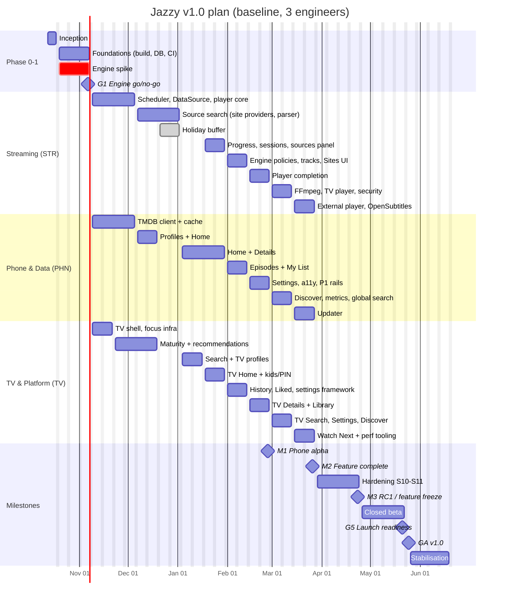

# Jazzy — Product Development Plan

| | |
|---|---|
| **Plan version** | 1.1 (sources: built-in torrent-site providers) |
| **Date** | 2026-10-10 |
| **Based on** | [`PRODUCT_SPEC.md`](PRODUCT_SPEC.md) v0.4 and the `../TorrentSearch` provider engine |
| **Planning horizon** | 2026-10-12 → 2027-06-18 (v1.0 GA + 4 weeks of stabilisation) |
| **Baseline team** | 3 Android engineers, 0.5 product designer, 0.5–1.0 QA, a product owner (see §4) |
| **Target GA** | **Tuesday 2027-05-25** (baseline scenario) |

> **How to read this plan.** §1 is the one-page summary. §5–§7 are the schedule. §8 is the full work breakdown, with every story estimated, owned, scheduled and traced back to spec requirement IDs. §9 shows how the estimates turn into dates, including the 2-engineer and solo alternatives. §10–§21 cover how the work gets done safely: the engine spike, design, engineering practices, testing, release, metrics, risks, decisions, dependencies and the post-launch roadmap.

---

## 1. Executive summary

**What we're building:** Jazzy, a single-APK Android phone and TV app. It offers Netflix-style browsing of TMDB content, per-profile libraries (My List, Liked, History, resume), recommendations from each profile's genres, and on-demand torrent streaming. The user picks a magnet link from a list sorted by seeders and plays it in a built-in player. Everything is stored locally in SQLite.

**How:** risk first. The streaming engine is the part most likely to fail, so a **3-week engine spike with a go/no-go gate** runs alongside the project setup before any feature UI is built. After that come 2-week sprints in three streams (Streaming, Phone & Data, TV & Platform). The TV stream builds each screen one sprint after its shared ViewModel lands on the phone. Then 4 weeks of hardening and a 4-week closed beta.

**Timeline (baseline, 3 engineers)**

| Milestone | Date | Meaning |
|---|---|---|
| Kick-off | Mon 2026-10-12 | Phase 0 (Inception) starts |
| **G1 — Engine go/no-go** | Fri 2026-11-06 | Spike proves magnet → ExoPlayer streaming meets the threshold targets on phone and TV |
| **M1 — Phone alpha** | Fri 2027-02-26 | Every P0 phone journey works end to end. Internal dogfooding starts. |
| **M2 — Feature complete** | Fri 2027-03-26 | All P0 and P1 scope on phone and TV |
| **M3 — RC1 / feature freeze** | Fri 2027-04-23 | Hardening done, release criteria met on the reference devices |
| Closed beta | 2027-04-26 → 2027-05-21 | 30–50 testers, phone and TV |
| **GA — v1.0** | **Tue 2027-05-25** | Public release through the chosen channel |
| Stabilisation | → 2027-06-18 | v1.0.x fixes, v1.1 planning |

**Effort:** 292 ideal engineer-days of planned stories, plus 20% contingency, comes to **≈ 350 engineer-days** (§9). The source search reuses the TorrentSearch engine (13 site providers, selector engine, progressive aggregation, fixture tests) instead of building it from scratch.

**Alternatives** (§9.4): with 2 engineers, GA ≈ **late August 2027**. Solo, a lean phone-only v1 lands ≈ **December 2027**, and the full scope ≈ **mid-2028**.

**Top risks** (§16): legal exposure and distribution channel · engine performance on weak TV hardware · **torrent-site breakage** (domains move, Cloudflare blocks, layout changes; in TorrentSearch's 2026-10-10 live check only 6 of the 10 public sites worked) · TV install base excluded by `minSdk 34` · single point of failure on the streaming engineer.

**Decisions needed before Fri 2026-10-16** (§17): D1 distribution channel · D2 legal review commissioned · D4 team size · D12 `minSdk` (the recommendation is to lower it to 28 for TV reach).

---

## 2. Scope, inputs and assumptions

### 2.1 In scope for v1.0
Every **P0 and P1** requirement in `PRODUCT_SPEC.md` v0.3, on phone/tablet and Android TV/Google TV:
profiles · Home with all P0+P1 rails · Details with the Sources list and episodes side panel · Search (incl. voice and Google TV global search) · Discover · built-in torrent-site source search (ported from TorrentSearch; Torznab as an optional provider) · torrent streaming engine · player (incl. episodes and sources side panels, next episode, subtitles, OpenSubtitles) · My List · Liked · History · resume points · genre recommendations · settings · local SQLite DB and TMDB cache · Watch Next · external player · accessibility · opt-in crash reporting and metrics · release tooling.

### 2.2 Out of scope for v1.0
All **P2** items and the spec's v2 candidates: cloud sync, offline downloads, casting, in-app trailers, Skip Intro, saved Discover rails, home-screen channel, JSON provider plugins (SRC-3, scheduled for v1.1), data export/import.

### 2.3 Assumptions
| # | Assumption | If wrong |
|---|---|---|
| A1 | 3 full-time Android engineers with Kotlin/Compose experience. At least one has native/JNI or media experience. | Re-baseline using §9.4 |
| A2 | 4.5 productive ideal days per engineer per week (meetings, reviews and support take the rest) | Dates move proportionally |
| A3 | Holiday period 2026-12-21 → 2027-01-01 runs at ~30% capacity, with no planned work | Gained capacity goes to the buffer |
| A4 | The **product owner** (the person commissioning Jazzy) is available for sprint reviews and decisions within 2 working days | Decision latency eats the buffer |
| A5 | A TMDB API key is available on day 1. Non-commercial use applies until D10 is decided. | Blocks E3 |
| A6 | Engineers have access to the reference devices in §13.5 by the start of S1 | Spike and TV work slip |
| A7 | Development and testing use **only legally distributable content**: Blender open movies, public-domain films, and generated test media in a local test swarm (§13.4) | Legal risk to the team |
| A8 | `minSdk` stays at 34 unless D12 changes it. Lowering it to 28 adds ~3 days of compatibility work, already inside the contingency. | — |

---

## 3. Delivery approach and principles

1. **Risk first.** The torrent → player pipeline is unproven and could invalidate the product. It's built and measured in Phase 1, before any feature UI. G1 is a real go/no-go, with fallbacks ready (§10.5).
2. **Vertical slices with a demo every sprint.** Each sprint ends with a working build that's been demoed on a real device. "Done" means merged, tested and demoed, not "code written".
3. **Local data first.** The SQLite schema, repositories and cache come before screens. UI reads from the DB, and the network only fills the DB (spec §8). That makes offline, resume and history correct by construction.
4. **One ViewModel, two UIs.** Each feature has one ViewModel and UiState shared by `ui/phone` and `ui/tv`. TV builds a screen **one sprint after** its phone ViewModel lands, so TV never waits on logic and never duplicates it.
5. **Measured, not assumed.** Streaming performance (time to first frame, rebuffering, seek), startup and jank are measured automatically from Phase 1 onward (E16-03), and tracked against the spec §9 targets every sprint.
6. **Legal hygiene from day 1.** CI and unit tests never touch live torrent sites. Providers are tested against MockWebServer fixtures with synthetic titles, and the live smoke test is opt-in and only runs searches. Streaming tests, demos and screenshots use only legal content (A7).
7. **Re-plan at gates.** At each gate (G1, M1, M2, M3) the plan is re-baselined against measured speed, and scope is cut before dates slip (cut order in §9.5).

---

## 4. Team, roles and ways of working

### 4.1 Roles
| Role | FTE | Code | Owns |
|---|---|---|---|
| **Product owner (PO)** | 0.3 | PO | Vision, priorities, the decision log (§17), acceptance of milestones, legal and distribution decisions |
| **Streaming engineer** (tech lead) | 1.0 | STR | Torrent engine, player, source search, playback data (progress, sessions), security review. Technical lead for architecture decisions (ADRs). |
| **Phone & Data engineer** | 1.0 | PHN | Database, TMDB integration and cache, phone UI (Home, Details, Library), design-system components, settings |
| **TV & Platform engineer** | 1.0 | TV | Build system, CI/CD, modules, TV UI, recommendations engine, search, release engineering, performance tooling |
| **Product designer** | 0.5 (Oct–Mar), 0.2 after | DES | IA, wireframes, hi-fi phone and TV, design tokens, motion, iconography, avatars, app icon and TV banner, UX copy |
| **QA engineer** | 0.5 (S3–S8), 1.0 (S9 → GA) | QA | Test plan, device/network/codec matrices, exploratory testing, regression, beta coordination, release sign-off input |
| **Legal advisor** (external) | ad hoc | LEGAL | Copyright exposure, TMDB terms, disclaimer copy, distribution policy (D2, D10) |

### 4.2 Responsibility matrix (R = responsible, A = accountable, C = consulted, I = informed)
| Activity | PO | STR | PHN | TV | DES | QA |
|---|---|---|---|---|---|---|
| Scope and priorities | A | C | C | C | C | I |
| Architecture / ADRs | I | A/R | C | C | – | I |
| Engine and player | I | A/R | C | C | C | C |
| Phone UI | C | C | A/R | C | C | C |
| TV UI | C | C | C | A/R | C | C |
| Design system | C | I | R | R | A | I |
| CI/CD and release tooling | I | C | C | A/R | – | C |
| Test strategy and sign-off | C | C | C | C | – | A/R |
| Go/no-go gates | A | R | R | R | C | R |
| Legal and distribution | A/R | C | I | C | I | I |

### 4.3 Ceremonies (2-week sprints, Monday start)
| Ceremony | When | Length | Output |
|---|---|---|---|
| Sprint planning | Mon, week 1 | 1.5 h | Sprint backlog, committed demo goal |
| Async stand-up | Daily (written, in the team channel) | – | Progress, blockers, help needed |
| Backlog refinement | Wed, week 1 | 1 h | Stories meeting the Definition of Ready for the next 2 sprints |
| Design review | Thu, weekly | 45 min | Designs approved one sprint ahead of build |
| Sprint demo | Fri, week 2 | 45 min | Live demo on a **real phone and TV**, PO acceptance |
| Retro | Fri, week 2 | 30 min | 1–3 process changes |
| Metrics review | Fri, week 2 | 15 min | Streaming and performance dashboard against the §9 targets |
| Gate review | At G1/M1/M2/M3/GA | 1–2 h | Go / no-go / re-plan decision recorded in §17 |

### 4.4 Communication and artefacts
- **Issue tracker:** one ticket per WBS story (§8), with IDs kept (`E9-03`). Epics map to milestones.
- **ADRs** in `docs/adr/` for every hard-to-reverse decision (engine bridge choice, DB split, provider interface, updater design).
- **Weekly status note** from the tech lead to the PO: progress against the plan, risks that changed, decisions needed.
- **Living docs:** `PRODUCT_SPEC.md` (what), `DEVELOPMENT_PLAN.md` (how and when), `docs/adr/*` (why), `docs/testing/*` (test plans and matrices).

---

## 5. Timeline

### 5.1 Phase overview
| Phase | Dates | Weeks | Goal | Exit |
|---|---|---|---|---|
| **0 — Inception** | 2026-10-12 → 10-16 | 1 | Decisions, backlog, devices, design kickoff | Phase 0 checklist (§6.1) done |
| **1 — Foundations + engine spike** | 2026-10-19 → 11-06 | 3 | Buildable modular skeleton, DB schema, CI, engine proven | **G1** |
| **2 — Build** | 2026-11-09 → 2027-03-26 | 18 (incl. 2 holiday weeks) | Sprints S1–S9: all P0 and P1 features, phone then TV | **M1** (end S7), **M2** (end S9) |
| **3 — Hardening** | 2027-03-29 → 04-23 | 4 | S10–S11: performance, accessibility, device matrix, bug burn-down | **M3 / RC1** |
| **4 — Closed beta** | 2027-04-26 → 05-21 | 4 | Real-world validation, RC2/RC3 | **G5 launch readiness** |
| **5 — Launch** | 2027-05-24 → 05-25 | – | GA release | GA |
| **6 — Stabilisation** | 2027-05-26 → 06-18 | 3.5 | v1.0.x hotfixes, v1.1 planning | v1.1 plan approved |

### 5.2 Sprint calendar
| Sprint | Dates | Theme | Gate at end |
|---|---|---|---|
| Phase 1 | Oct 19 – Nov 06 | Foundations + engine spike | **G1** (Nov 06) |
| S1 | Nov 09 – Nov 20 | Data in, pieces out | – |
| S2 | Nov 23 – Dec 04 | First playable | – |
| S3 | Dec 07 – Dec 18 | Profiles and sources | – |
| *Holiday* | Dec 21 – Jan 01 | Buffer / catch-up only | – |
| S4 | Jan 04 – Jan 15 | Details → Play | – |
| S5 | Jan 18 – Jan 29 | Library and resume | – |
| S6 | Feb 01 – Feb 12 | Episodes and engine policies | – |
| S7 | Feb 15 – Feb 26 | Player complete, TV Details | **M1** (Feb 26) |
| S8 | Mar 01 – Mar 12 | TV breadth and P1 features | – |
| S9 | Mar 15 – Mar 26 | P1 completion and performance tooling | **M2** (Mar 26) |
| S10 | Mar 29 – Apr 09 | Hardening I: performance and device matrix | – |
| S11 | Apr 12 – Apr 23 | Hardening II: bug burn-down, RC1 | **M3** (Apr 23) |
| Beta | Apr 26 – May 21 | Closed beta, RC2–RC3 | **G5** (May 21) |
| GA | May 25 | v1.0 release | – |

### 5.3 Gantt


### 5.4 Critical path
```
E9-00 spike → E9-03 piece scheduler → E9-04 TorrentDataSource → E10-01 player core
   → E11-03 progress writer / E11-04 session recorder → E11-05 Continue Watching + next episode
   → E10-09 next-episode logic → M1 → E14-05/06 TV Details → M2 → hardening → RC1 → beta → GA
Parallel near-critical path: E3-01/02 TMDB + cache → E5 Home → E6 Details/Sources UI (needs E8) → E14 TV screens
```
Any slip on the critical path moves M1 day for day. Near-critical items have about 1 sprint of float, absorbed by the holiday buffer and S9.

---

## 6. Phase plans

### 6.1 Phase 0 — Inception (Oct 12–16)
| # | Activity | Owner | Output |
|---|---|---|---|
| 0.1 | Decide D1 (distribution), D4 (team), D12 (`minSdk`). Commission D2 (legal review). Start D10 (TMDB terms). | PO | Decision log entries |
| 0.2 | Create the tracker project. Import the WBS (§8) as tickets with estimates, owners and sprints. | TV | Backlog |
| 0.3 | Order or allocate the reference devices (§13.5). Set up the test Wi-Fi with a throttling router or traffic shaper. | PO/TV | Devices on desks by S1 |
| 0.4 | Get a TMDB API key and read access token. Store them in the team secret store. | PO | Secret available to CI |
| 0.5 | Review the TorrentSearch engine for porting (`engine/` package, provider fixtures, live smoke test). Re-run its live smoke test to confirm which sites work today. Write the port plan (ADR-005). | STR | Port plan and current provider status |
| 0.6 | Design kickoff: IA walkthrough, references, mood board, dark-theme direction, brand name/icon brief (D3) | DES/PO | Design brief |
| 0.7 | Write ADR-001 (modular architecture), ADR-002 (two-DB SQLite), ADR-003 (engine bridge: DataSource first) | STR | ADRs |
| 0.8 | Agree the Definition of Ready and Done (§12.5), branching and review rules | All | Team agreement |
| 0.9 | Draft the test strategy and device/codec/network matrices (§13) | QA (or STR until QA joins) | `docs/testing/strategy.md` |

**Exit:** D1/D4/D12 decided (or explicitly defaulted), backlog loaded, devices ordered, secrets available, ADR-001…003 merged.

### 6.2 Phase 1 — Foundations + engine spike (Oct 19 – Nov 6)
**Goal:** a buildable, CI-checked modular project with the full DB schema. In parallel, **evidence** that magnet → ExoPlayer streaming works well enough on phone and TV.

| Stream | Work (WBS IDs) |
|---|---|
| STR | E9-00 spike, E9-01 libtorrent4j integration, E9-02 magnet → metadata → file selection, E9-12 local test swarm, E16-03 streaming benchmark logging |
| PHN | E0-05 secrets, E0-09 flags and debug menu, E1-01 phone theme, E2-01/02/03/04/06/08 databases, settings repository, snapshots, seed data |
| TV | E0-01/02/03/04 catalog, convention plugins, modules, Java 17/R8/ABI · E0-06/07 CI and managed devices · E0-08 phone + TV app shells · E1-02 TV theme · E2-05 Keystore and PIN hashing · E2-07 backup rules |
| DES | Wireframes for all P0 phone screens. Hi-fi for Home, Details (movie + show), Sources list, Player. Design tokens v1. |

**Demo (Nov 6):** (1) The app launches on phone and TV into placeholder shells, and CI is green. (2) Both databases are created, with migration tests running. (3) **A public-domain magnet plays in ExoPlayer on a phone and on a Chromecast with Google TV**, with live peers and rate stats, seek working, and time to first frame (TTFF) logged.

**G1 go/no-go criteria:** see §10.4.

### 6.3 Phase 2 — Build sprints (S1–S9)
Each sprint below lists its goal, stories by stream, and the demo that proves it. Story details are in §8.

#### S1 (Nov 9–20) — "Data in, pieces out"
| Stream | Stories |
|---|---|
| STR | E9-03 piece scheduler · E9-05 seek re-prioritisation · E9-06 stats flow |
| PHN | E3-01 TMDB client and DTOs · E3-02 cache-first repository · E3-04 limiter and interceptors · E3-05 images and Coil |
| TV | E1-03b TV cards · E1-07 screenshot tests · E14-01 TV nav drawer · E14-02 focus infrastructure |
| DES | Hi-fi: Profiles, Search, Library (My List/Liked/History), Settings. TV wireframes for all screens. |
| QA | (joins S3) |

**Demo:** a debug screen lists Trending/Popular from the SQLite cache, then works offline with the network off. A public-domain movie seeks to 75% and resumes in under 8 s. TV drawer navigation works with full focus restoration.

#### S2 (Nov 23 – Dec 4) — "First playable"
| Stream | Stories |
|---|---|
| STR | E9-04 TorrentDataSource (production) · E9-07 foreground service · E10-01 player screen and pre-roll |
| PHN | E3-03 Paging RemoteMediator · E3-07 cache eviction worker · E1-03a phone cards · E1-04 rail, hero, skeleton, states |
| TV | E3-06 maturity filtering · E12-01 genre lists and unified mapping · E12-02 affinity scoring engine · E19-01 signing and versionCode |
| DES | TV hi-fi: Home, Details (movie + show with episodes panel), Player chrome. Motion specs. |

**Demo:** rails page through TMDB with cached pages. A hard-coded magnet plays in the real Player screen with pre-roll stats, in the foreground service, and survives screen-off. Unit tests for the scoring engine pass the golden cases.

#### S3 (Dec 7–18) — "Profiles and sources"
| Stream | Stories |
|---|---|
| STR | E8-01 port the TorrentSearch engine into `:core:sources` · E8-02 port the site providers and their fixture tests · E8-04 release-name parser (200-case corpus) |
| PHN | E3-08 TMDB contract tests · E4-01 profile picker · E4-02 create/edit profile · E4-06 profile scoping · E4-08 remember profile · E5-01 Home scaffold |
| TV | E12-03 rail builders · E12-04 triggers and WorkManager · E12-05 reset and edit genres · E18-01 crash reporting (opt-in) · E19-02 release pipeline · E17-03 string externalisation |
| QA | Joins. Test plan v1, device matrix set up, first exploratory pass on the debug builds. |

**Demo:** create two profiles and switch between them without a restart. Fixture-backed site providers return results that are parsed, de-duplicated and sorted by seeders in a debug list. A debug build searches the live public sites for a public-domain title. A signed internal build comes out of a CI tag.

#### Holiday (Dec 21 – Jan 1)
No planned work. Optional catch-up on spill-over, dependency upgrades, and a refactoring backlog.

#### S4 (Jan 4–15) — "Details → Play"
| Stream | Stories |
|---|---|
| STR | E8-03 query builder · E8-05 match, cross-site de-dupe, sort · E8-07 source result cache · E8-09 source flags · E8-11 lazy magnet resolution and verification · E10-02 phone player controls |
| PHN | E5-02 hero · E5-03 P0 TMDB rails · E5-07 rail rules · E1-05 dialogs, sheets, side panel scaffold · E6-01 Details header |
| TV | E7-01..04 Search (phone) · E14-04 TV profiles · E4-03 genre picks onboarding · E8-06 device capability probe |

**Demo (end-to-end, phone):** Profile → Home → hero/rails → Details header → (debug) source list → ▶ Play → playback with controls. Search works with recents.

#### S5 (Jan 18–29) — "Library and resume"
| Stream | Stories |
|---|---|
| STR | E11-03 progress writer · E11-04 play-session recorder · E11-07 resume across sources · E11-05 Continue Watching and next-episode promotion · E10-07 sources side panel in player · E9-08 storage manager and LRU |
| PHN | E6-07 DetailsViewModel orchestration · E6-02 Sources list UI · E6-03 resume banner and rows · E5-04 local rails |
| TV | E14-03 TV Home (dynamic backdrop) · E4-04 Kids mode · E4-05 PINs · E1-06 avatars and icon · E4-07 delete-profile cascade |

**Demo:** open a movie and the Sources list fills progressively. Play from row 3, stop at 10:00, kill the app, reopen: Continue Watching shows it, Details shows **Resume 10:00** on row 3, and resume works from a different row too. TV Home is navigable with the remote.

#### S6 (Feb 1–12) — "Episodes and engine policies"
| Stream | Stories |
|---|---|
| STR | E9-09 seeding and network policies · E9-10 stall detector · E10-03 tracks and subtitles · E8-08 Sites settings UI |
| PHN | E6-04 show layout and episodes · E6-05 expanded-width two-pane · E6-06 More Like This and unreleased warning · E11-01 My List |
| TV | E11-06 History screen · E11-02 Liked · E5-05 recommendation rails on Home · E13-01 settings framework |

**Demo:** a TV show's season list → episode → that episode's sources → play. In landscape the episodes appear as a side panel. My List and Liked are populated, and History is grouped by day. Recommended for You changes after watching two sci-fi titles. Settings → Sources lists every built-in site with health, and supports Test, mirror URL overrides and private-site logins.

#### S7 (Feb 15–26) — "Player complete, TV Details" → **M1**
| Stream | Stories |
|---|---|
| STR | E10-05 PiP · E10-06 media session · E10-08 episodes side panel in player · E10-09 next episode · E10-10 error handling |
| PHN | E13-02 settings sections · E13-04 About, attribution, licences · E18-04 disclaimer · E17-01 TalkBack semantics · E17-02 font scale and contrast · E5-06 P1 rails |
| TV | E14-05 TV Details (movie) · E14-06 TV Details (show, episodes side panel, sources slide-in) · E14-08 TV Library |

**Demo / M1:** the full phone journey for a movie and a show, including next-episode autoplay from a season pack. The internal alpha starts on team phones.

#### S8 (Mar 1–12) — "TV breadth and P1 features"
| Stream | Stories |
|---|---|
| STR | E10-11 FFmpeg extension · E10-12 TV remote controls and TV player chrome · E13-03 network, storage and local-data settings · E18-03 security review |
| PHN | E15-01 Discover · E18-02 opt-in metrics · E7-05 global search provider · E10-04 player gestures |
| TV | E14-07 TV Search and voice · E14-09 TV Settings · E14-12 TV Discover · E14-11 TV polish and 2 GB profiling |

**Demo:** a full TV journey with the remote only, including voice search and DTS audio decoded in software. Discover works on both form factors.

#### S9 (Mar 15–26) — "P1 completion and performance tooling" → **M2**
| Stream | Stories |
|---|---|
| STR | E9-11 loopback server and external player · E10-13 OpenSubtitles · E8-10 live provider smoke test and health report · E8-12 Torznab provider |
| PHN | E19-03 in-app updater (if D1 = sideload) · E19-04 beta channel · buffer |
| TV | E14-10 Watch Next · E16-01 Baseline Profiles · E16-02 macrobenchmarks |

**Demo / M2:** every P0 and P1 story is merged. Baseline Profiles are applied, and the macrobenchmark report is compared against §9 of the spec.

### 6.4 Phase 3 — Hardening (S10–S11, Mar 29 – Apr 23)
| Track | Activities | Owner |
|---|---|---|
| Performance | E16-04 optimisation: cold start, rail jank, TTFF, memory on 2 GB TV, DB query plans (`EXPLAIN QUERY PLAN` on the history/progress queries) | All |
| Streaming soak | 2 h continuous playback ×10 runs per reference device. 50 seeks per run. Network drops and recovery. | STR/QA |
| Device matrix | Full regression on every device in §13.5, plus codec matrix §13.6 | QA |
| Accessibility audit | TalkBack walkthrough, Switch Access, D-pad-only, 200% font, contrast | QA/PHN |
| Data safety | Migration tests from every pre-release schema, backup/restore of `jazzy.db`, profile delete cascade, cache clear keeping user data | PHN/QA |
| Security | Fix findings from E18-03. Dependency vulnerability scan. Exported-component audit. | STR |
| Bug burn-down | Daily triage, with severity rules in §13.8 | All |
| Release prep | Release notes, store/landing assets, legal copy final, update server dry run | PO/TV/DES |

**M3 / RC1 exit criteria:** zero open S1 bugs · ≤ 5 open S2 bugs, each with a workaround · every spec §9 target met on the reference devices (or a waiver signed by the PO) · migration tests green · legal review closed (D2) · RC1 signed and distributed to beta testers.

### 6.5 Phase 4 — Closed beta (Apr 26 – May 21)
| Week | Focus |
|---|---|
| B1 | Onboard 30–50 testers (≥ 15 on TV devices, a mix of the device models in §13.5). Guided tasks: create profiles, play a movie and an episode, resume, like and list, try a mirror override. |
| B2 | Free use. Daily crash and metrics review. RC2 with fixes. |
| B3 | Targeted tests: weak networks, low storage, long sessions, kids profiles. Survey #1. |
| B4 | RC3 (release candidate). Regression on the full matrix. Survey #2. Go/no-go (G5). |

**Beta success criteria (G5):** crash-free sessions ≥ 99.5% · playback success ≥ 85% (Play press → first frame) · TTFF p50 ≤ 15 s on healthy sources · rebuffering < 1 per 30 min p50 · no data-loss reports · System Usability Scale ≥ 70 · **sources found** for ≥ 90% of Details opens on popular titles (at least one row with ≥ 10 seeders) · each default-enabled site healthy on ≥ 80% of beta days, or swapped for a working mirror or disabled before GA.

### 6.6 Phase 5 — Launch (May 24–25)
Launch checklist in §14.6. GA on **Tue 2027-05-25**, with the update manifest set to roll out staged: 10% → 50% → 100% over 72 h for in-app updates.

### 6.7 Phase 6 — Stabilisation (May 26 – Jun 18)
- Hotfix cadence: v1.0.1 within 7 days of GA if needed, then as needed.
- Daily crash and metrics review for 2 weeks, then weekly.
- v1.1 planning on 2027-06-14, using beta and launch feedback (roadmap in §20).

---

## 7. Design workstream plan

| When | Deliverable | Needed by |
|---|---|---|
| Phase 0 | Design brief, mood board, dark-theme direction, name/icon brief | Phase 1 |
| Phase 1 | IA v1. Wireframes for all P0 phone screens. Hi-fi: Home, Details (movie/show), Sources list, Player. Tokens v1 (colour, type, spacing, shape, elevation, motion). | S1 (PHN builds tokens and cards) |
| S1 | Hi-fi: Profiles (picker, create/edit, PIN pad, genre picks), Search, Library (My List/Liked/History), Settings. TV wireframes for every screen. | S2–S4 |
| S2 | TV hi-fi: Home (hero + dynamic backdrop + focus states), Details movie/show (two-pane, episodes side panel, sources slide-in), Player chrome (TV). Motion specs (focus scale, panel slide, hero cross-fade). | S5–S7 |
| S3 | Empty, error, offline and loading states for every screen. Source-row badge system (quality, CAM warning, may-not-play, season pack, last played, failed recently). Avatar set (24). App icon and 320×180 TV banner. | S4 |
| S4–S5 | Player overlays: episodes side panel, sources panel, next-episode countdown, stall prompt, resume/start-over dialog | S6–S7 |
| S6 | Discover, Settings detail screens, Sites settings (health, mirror override, private-site login), "all sites failing" state | S8 |
| S7–S8 | Accessibility review of builds, UX copy pass, TV 10-foot readability review on real TVs | S10 |
| S9–Beta | Landing page and release assets, beta survey design, usability test (5 users phone + 5 TV) | Beta |

**Design Definition of Done:** phone and TV variants, every state (loading, empty, error, offline), focus states for TV, TalkBack labels noted, tokens only (no ad-hoc values), reviewed by an engineer for feasibility.

---

## 8. Work breakdown structure

**Columns:** `Est` = ideal engineer-days. `Pri` = spec priority. `Owner` = STR / PHN / TV (§4.1). `Sprint` = Ph1 (Phase 1), S1–S9, or HRD (hardening). `Deps` = stories that must be merged first.
Spec references use the requirement IDs from `PRODUCT_SPEC.md` v0.3.

### E0 — Project setup and build infrastructure (12 d)
| ID | Story | Spec | Est | Pri | Owner | Sprint | Deps |
|---|---|---|---|---|---|---|---|
| E0-01 | Version catalog: Compose BOM, Hilt, KSP, Room, Media3, Coil 3, Paging, WorkManager, Retrofit/OkHttp, kotlinx.serialization, Jsoup, libtorrent4j, tv-material, tvprovider (latest stable, pinned) | §8 | 1 | P0 | TV | Ph1 | – |
| E0-02 | `build-logic` convention plugins: application, library, compose, hilt, room, feature, jvm-test | §8 | 2 | P0 | TV | Ph1 | E0-01 |
| E0-03 | Module skeleton (`:core:*`, `:feature:*`), dependency rules (feature modules never depend on each other) | §8 | 1.5 | P0 | TV | Ph1 | E0-02 |
| E0-04 | Java 17, R8 baseline rules, ABI splits, 16 KB page-size alignment check for native libs, application ID per D3 | §8 | 1 | P0 | TV | Ph1 | E0-02 |
| E0-05 | TMDB token from `local.properties` / CI secret → `BuildConfig`. Build types `debug`, `internal`, `release`. | §6.1 | 0.5 | P0 | PHN | Ph1 | E0-02 |
| E0-06 | CI (GitHub Actions): assemble, lint, ktlint/detekt, unit tests, Room schema diff check, dependency guard, APK size report, artefact upload | – | 2 | P0 | TV | Ph1 | E0-03 |
| E0-07 | Gradle Managed Devices: phone API 34 + latest, TV API 34. Nightly instrumented run. | – | 1.5 | P0 | TV | Ph1 | E0-06 |
| E0-08 | Phone and TV entry points in one APK, manifest features (leanback/touchscreen not required), form-factor detection | §5.10 | 1 | P0 | TV | Ph1 | E0-03 |
| E0-09 | Feature flags (DB-backed) and debug menu: environment switch, DB inspector link, engine stats, fixture-providers toggle | – | 1.5 | P0 | PHN | Ph1 | E2-04 |

### E1 — Design system in code (16 d)
| ID | Story | Spec | Est | Pri | Owner | Sprint | Deps |
|---|---|---|---|---|---|---|---|
| E1-01 | Phone M3 theme from tokens (colour, type, spacing, shape, elevation), dark-first | §8 | 2 | P0 | PHN | Ph1 | E0-03 |
| E1-02 | TV theme (tv-material), focus indication, overscan-safe scaffold (48/27 dp) | §5.10 | 2 | P0 | TV | Ph1 | E0-03 |
| E1-03a | Phone cards: poster (♥/✓ markers), backdrop + progress, top-10, episode row, **source row** (badges, health dot, Play/Resume) | §5.2, §5.3.2 | 2.5 | P0 | PHN | S2 | E1-01 |
| E1-03b | TV variants of all cards with focus scale/outline | §5.2, §5.10 | 2.5 | P0 | TV | S1 | E1-02 |
| E1-04 | Rail, hero billboard, skeleton/shimmer, empty/error/offline components | §5.2 | 3 | P0 | PHN | S2 | E1-03a |
| E1-05 | Undo snackbar, PIN pad, resume/start-over dialog, bottom sheet, side-panel scaffold | §5.3, §5.6 | 2 | P0 | PHN | S4 | E1-01 |
| E1-06 | Avatar set (24), app icon, TV banner integration | PR-2, §5.10 | 0.5 | P0 | TV | S5 | DES assets |
| E1-07 | Screenshot test harness (Roborazzi) for components, phone and TV | – | 1.5 | P0 | TV | S1 | E1-02 |

### E2 — Local database (12.5 d)
| ID | Story | Spec | Est | Pri | Owner | Sprint | Deps |
|---|---|---|---|---|---|---|---|
| E2-01 | `jazzy.db` entities and DAOs: profile, app/profile settings, title_snapshot, my_list_item, liked_title, watch_progress, play_session, search_history, seed_genre, genre_affinity, provider_setting, source_flag, originals_network, public_tracker | §7.1 | 4 | P0 | PHN | Ph1 | E0-03 |
| E2-02 | `jazzy_cache.db` entities and DAOs: tmdb_config, genre, tmdb_list_page, tmdb_title, tmdb_season, tmdb_search, source_result, recommendation_cache, torrent_cache_entry | §7.2 | 2 | P0 | PHN | Ph1 | E0-03 |
| E2-03 | Schema export, `MigrationTestHelper`, migration policy (destructive only on the cache DB), WAL | §7 | 1 | P0 | PHN | Ph1 | E2-01 |
| E2-04 | Settings repository on SQLite (typed keys, `Flow`), replacing DataStore | §5.11 | 1.5 | P0 | PHN | Ph1 | E2-01 |
| E2-05 | Keystore-backed encryption for private-site credentials and cookies. PBKDF2 PIN hashing. | §7 | 1.5 | P0 | TV | Ph1 | E2-01 |
| E2-06 | Title-snapshot upsert and retention (kept while referenced by a list, history or progress row) | §6.3, §7.1 | 1 | P0 | PHN | Ph1 | E2-01 |
| E2-07 | `backup_rules.xml` / `data_extraction_rules.xml`: include `jazzy.db`, exclude the cache DB and torrent data | §8 | 0.5 | P0 | TV | Ph1 | E2-01 |
| E2-08 | Seed data on create: Originals networks, public trackers, unified genre mapping (bundled JSON) | §5.2, §5.7 | 1 | P0 | PHN | Ph1 | E2-01 |

### E3 — TMDB integration and cache (17.5 d)
| ID | Story | Spec | Est | Pri | Owner | Sprint | Deps |
|---|---|---|---|---|---|---|---|
| E3-01 | Retrofit service and DTOs: configuration, genres, trending, movie/tv lists, discover, details with `append_to_response`, seasons, search/multi, person credits, images | §5.2–§5.5, §6 | 4 | P0 | PHN | S1 | E0-05 |
| E3-02 | Generic cache-first-then-revalidate repository helper: TTLs, stale serving, error/offline states, `last_accessed_at` touch | §6.3 | 3 | P0 | PHN | S1 | E2-02 |
| E3-03 | Paging 3 `RemoteMediator` for rails, search and discover | §5.2, §5.4 | 3 | P0 | PHN | S2 | E3-02 |
| E3-04 | Concurrency limiter (8), 429 backoff + `Retry-After`, auth interceptor, language/region interceptor | §6.3 | 1 | P0 | PHN | S1 | E3-01 |
| E3-05 | Image URL builder from `/configuration`, per-form-factor sizes, Coil disk cache sizing | §6.1 | 1 | P0 | PHN | S1 | E3-01 |
| E3-06 | Maturity filtering: certification on discover, `release_dates` post-filter, TV `content_ratings`, kids genre restriction | §6.4, PR-4 | 3 | P0 | TV | S2 | E3-01 |
| E3-07 | Cache eviction worker: 150 MB cap LRU, 30-day idle purge | §6.3 | 1 | P0 | PHN | S2 | E3-02 |
| E3-08 | Contract tests with recorded TMDB fixtures (MockWebServer) | – | 1.5 | P0 | PHN | S3 | E3-01 |

### E4 — Profiles (10.5 d)
| ID | Story | Spec | Est | Pri | Owner | Sprint | Deps |
|---|---|---|---|---|---|---|---|
| E4-01 | "Who's watching?" picker (phone) | PR-1 | 1.5 | P0 | PHN | S3 | E2-01, E1-01 |
| E4-02 | Create/edit profile: name, avatar, maturity, languages | PR-2 | 2 | P0 | PHN | S3 | E4-01 |
| E4-03 | Optional genre-picks step | PR-3 | 1 | P0 | TV | S4 | E12-01, E4-02 |
| E4-04 | Kids mode wiring (filters, hidden source settings, simplified UI) | PR-4 | 1.5 | P0 | TV | S5 | E3-06 |
| E4-05 | Profile and parental PINs, lock flows | PR-5 | 2 | P0 | TV | S5 | E2-05, E1-05 |
| E4-06 | Active-profile scoping across repositories. Switch without restart. | PR-6, PR-8 | 1.5 | P0 | PHN | S3 | E4-01 |
| E4-07 | Delete-profile cascade, last-profile guard | PR-7 | 0.5 | P0 | TV | S5 | E4-06 |
| E4-08 | "Remember my profile" | PR-1 | 0.5 | P0 | PHN | S3 | E4-01 |

### E5 — Home, phone (11.5 d)
| ID | Story | Spec | Est | Pri | Owner | Sprint | Deps |
|---|---|---|---|---|---|---|---|
| E5-01 | Home scaffold, Movies/TV tabs, pull to refresh, offline banner | HM-1, 2, 4, 5 | 2 | P0 | PHN | S3 | E1-04, E3-03 |
| E5-02 | Hero billboard: selection logic, logo fetch, actions (Watch, My List, Like, More Info) | §5.2 | 2 | P0 | PHN | S4 | E5-01 |
| E5-03 | P0 TMDB rails: Trending, Popular, Top Rated, Upcoming, Originals | §5.2 | 2 | P0 | PHN | S4 | E5-01 |
| E5-04 | Local rails: Continue Watching (with menu), My List, Liked | §5.2, HM-7 | 1.5 | P0 | PHN | S5 | E11-05 |
| E5-05 | Recommendation rails on Home | §5.7 | 1 | P0 | TV | S6 | E12-03 |
| E5-06 | P1 rails: Top 10, Now Playing, Discover picks, genre rails | §5.2 | 2 | P1 | PHN | S7 | E5-03 |
| E5-07 | Rail ordering, hide-empty, per-rail error/retry | HM-1, HM-3 | 1 | P0 | PHN | S4 | E5-03 |

### E6 — Details, Sources list and episodes, phone (16 d)
| ID | Story | Spec | Est | Pri | Owner | Sprint | Deps |
|---|---|---|---|---|---|---|---|
| E6-01 | Header: metadata, logo, cast, actions (My List, Like, Trailer) | DT-1, 2, 4 | 2.5 | P0 | PHN | S4 | E3-01, E1-03a |
| E6-02 | **Sources list UI:** rows, badges, sort, filter chips, dead-links toggle, per-site progress and failure reasons, all states | SL-1…8 | 4 | P0 | PHN | S5 | E8-05, E1-03a |
| E6-03 | Resume banner, Resume/Start-over on rows, "Last played" badge | DT-3, SL-6 | 1.5 | P0 | PHN | S5 | E11-03 |
| E6-04 | Show layout: season dropdown, episode list (watched/progress), episode Sources in a bottom sheet | §5.3.3 | 3 | P0 | PHN | S6 | E6-02 |
| E6-05 | Expanded-width two-pane with episodes side panel | §5.3.3 | 2 | P0 | PHN | S6 | E6-04 |
| E6-06 | More Like This, unreleased warning | DT-5, DT-6 | 1 | P0 | PHN | S6 | E6-01 |
| E6-07 | DetailsViewModel: metadata and source search in parallel, episode-scoped search, source cache use | §5.3 | 2 | P0 | PHN | S5 | E8-01, E6-01 |

### E7 — Search (6.5 d)
| ID | Story | Spec | Est | Pri | Owner | Sprint | Deps |
|---|---|---|---|---|---|---|---|
| E7-01 | Search screen: debounce, paged `/search/multi`, chips, grid | SR-1, SR-4, SR-5 | 2 | P0 | TV | S4 | E3-03 |
| E7-02 | Recent searches (per profile, in SQLite) and popular searches | SR-3 | 1 | P0 | TV | S4 | E7-01 |
| E7-03 | Person filmography grid | SR-1 | 1 | P0 | TV | S4 | E7-01 |
| E7-04 | Voice input (phone) | SR-2 | 0.5 | P0 | TV | S4 | E7-01 |
| E7-05 | System / Google TV global search provider | SR-6 | 2 | P1 | PHN | S8 | E7-01 |

### E8 — Source search: built-in torrent-site providers (24.5 d)
The engine comes from `../TorrentSearch` (`engine/` package: `Selector`, `TorrentProvider`, `ProviderManager`, `Http`, `Sizes`, 13 site providers plus MagnetDL, `MockWebServer` fixture tests). It's ported, not rewritten. The work is adapting it to Jazzy's modules, Hilt, SQLite settings and the Sources list, plus the Jazzy-specific parts: TMDB-driven queries, matching, cross-site de-duplication and magnet verification.

| ID | Story | Spec | Est | Pri | Owner | Sprint | Deps |
|---|---|---|---|---|---|---|---|
| E8-01 | Port the TorrentSearch engine core into `:core:sources` (selector language, provider base, progressive aggregation, HTTP/cookies, sizes). Swap DataStore for SQLite `provider_setting`, add Hilt wiring, set the per-site timeout to 15 s, keep the "no challenge solving" rule. | SRC-1, SRC-6 | 2.5 | P0 | STR | S3 | E2-01 |
| E8-02 | Port the site provider definitions with their fixture tests. Default enablement (working public sites on; blocked/dead/private off). Movies/TV category mapping per site. | SRC-2, SRC-3 | 3 | P0 | STR | S3 | E8-01 |
| E8-03 | Query builder from TMDB data: title + year, original title, YTS by IMDb ID, SxxEyy, season and complete-series packs, normalisation | §5.8 | 2 | P0 | STR | S4 | E3-01, E8-02 |
| E8-04 | Release-name parser (resolution, source, codec, HDR, audio, S/E, year, packs) with a 200-case test corpus | §5.8 | 4 | P0 | STR | S3 | – |
| E8-05 | Title/year/episode match filter, **cross-site de-dupe** (info-hash, else title + size), sort seeders → resolution → size | SL-1, SL-2, SRC-8 | 2 | P0 | STR | S4 | E8-04 |
| E8-06 | Device capability probe (`MediaCodecList`, HDR/DV, audio passthrough) → "may not play" | SL-4 | 1.5 | P0 | TV | S4 | – |
| E8-07 | Source result cache (15 min) and background seed refresh | SL-9 | 1 | P0 | STR | S4 | E2-02 |
| E8-08 | Sites settings UI: enable/disable, mirror URL override, private-site login/cookies, health and Test | SRC-4, SRC-5 | 3 | P0 | STR | S6 | E8-02, E2-05 |
| E8-09 | Source flags (bad for 24 h) | SL-7 | 0.5 | P0 | STR | S4 | E2-01 |
| E8-10 | Live provider smoke test (opt-in nightly, non-blocking, search only) and a provider health report in the debug menu | SRC-5 | 1 | P0 | STR | S9 | E8-02 |
| E8-11 | Lazy magnet resolution on Play (detail-page scrape, "Getting link…" state) and **magnet verification** after metadata (bait-and-switch guard) | SRC-7, TE-2 | 2 | P0 | STR | S4 | E8-02, E9-02 |
| E8-12 | Optional Torznab provider (caps, ID-based search, XML) | SRC-9 | 2 | P1 | STR | S9 | E8-01 |

### E9 — Torrent streaming engine (35 d)
| ID | Story | Spec | Est | Pri | Owner | Sprint | Deps |
|---|---|---|---|---|---|---|---|
| E9-00 | **Engine spike:** prototype scheduler + DataSource, measurement runs, spike report and G1 recommendation (§10) | – | 4 | P0 | STR | Ph1 | – |
| E9-01 | libtorrent4j integration: session lifecycle, settings pack, alert loop, per-ABI native libs | TE-1 | 3 | P0 | STR | Ph1 | E0-04 |
| E9-02 | Magnet → metadata (timeout, tracker injection), file selection (largest / episode match / skip samples) | TE-2, TE-3 | 2.5 | P0 | STR | Ph1 | E9-01 |
| E9-03 | Piece scheduler: head/tail priority, read-ahead deadlines, adaptive window, background priority | TE-4 | 6 | P0 | STR | S1 | E9-02 |
| E9-04 | `TorrentDataSource`: blocking reads on piece alerts, timeouts, cancellation, `DataSpec` ranges | TE-6, §5.9.2 | 4 | P0 | STR | S2 | E9-03 |
| E9-05 | Seek re-prioritisation | TE-5 | 2 | P0 | STR | S1 | E9-03 |
| E9-06 | Stats `Flow` (rates, peers, buffered seconds, %) | TE-12 | 1 | P0 | STR | S1 | E9-01 |
| E9-07 | Foreground service (`mediaPlayback`), notification, lifecycle | TE-8 | 2 | P0 | STR | S2 | E9-01 |
| E9-08 | Storage manager: cap (default = min(spec default, 50% of free space)), LRU eviction, clear | TE-9 | 2 | P0 | STR | S5 | E2-02 |
| E9-09 | Seeding/upload policy. Network rules (Wi-Fi only, metered warning, port, UPnP, encryption). | TE-10, TE-11 | 2 | P0 | STR | S6 | E9-01 |
| E9-10 | Stall detector and "try next source" prompt | TE-7 | 2 | P0 | STR | S6 | E9-06, E6-02 |
| E9-11 | Loopback HTTP server (token, Range) and "Open in external player" | §5.9.2 | 2.5 | P1 | STR | S9 | E9-04 |
| E9-12 | Local test swarm harness (seeder + tracker on loopback) for instrumented tests | – | 2 | P0 | STR | Ph1 | E9-01 |

### E10 — Player (32.5 d)
| ID | Story | Spec | Est | Pri | Owner | Sprint | Deps |
|---|---|---|---|---|---|---|---|
| E10-01 | Player screen, ExoPlayer factory, renderer config, pre-roll screen | PL-1, PL-3 | 3 | P0 | STR | S2 | E9-04 |
| E10-02 | Phone controls: scrub with buffered ranges, ±10 s, speed, aspect, stats overlay | PL-4 | 3 | P0 | STR | S4 | E10-01 |
| E10-03 | Audio/subtitle track selection, embedded and sidecar subtitles, subtitle styling, per-profile language memory | PL-8 | 2.5 | P0 | STR | S6 | E10-01 |
| E10-04 | Gestures: double-tap seek, brightness/volume swipe, pinch zoom, landscape lock | PL-7 | 2 | P0 | PHN | S8 | E10-02 |
| E10-05 | Picture-in-Picture | PL-7 | 1.5 | P0 | STR | S7 | E10-02 |
| E10-06 | Media session, notification, Google TV "Now Playing" | PL-11 | 1.5 | P0 | STR | S7 | E10-01 |
| E10-07 | Sources side panel in player (switch and keep position) | PL-4 | 2 | P0 | STR | S5 | E6-02 |
| E10-08 | Episodes side panel in player (season switch, marks, episode → sources) | PL-5 | 2.5 | P0 | STR | S7 | E6-04 |
| E10-09 | Next episode: countdown, season-pack continuation, prefetch at 80% | PL-10 | 3 | P0 | STR | S7 | E11-05, E10-08 |
| E10-10 | Error handling: unsupported codec, corrupt file, metadata timeout | PL-12 | 1.5 | P0 | STR | S7 | E8-09 |
| E10-11 | FFmpeg decoder extension (LGPL config, DTS/TrueHD), CI build of the `.so` | PL-2 | 3 | P0 | STR | S8 | E10-01 |
| E10-12 | TV remote mapping and TV player chrome | PL-6 | 3 | P0 | STR | S8 | E10-02, E1-02 |
| E10-13 | OpenSubtitles: search by IMDb ID and language, download, sync offset | PL-8 | 4 | P1 | STR | S9 | E10-03 |

### E11 — Library: My List, Liked, History, resume (15 d)
| ID | Story | Spec | Est | Pri | Owner | Sprint | Deps |
|---|---|---|---|---|---|---|---|
| E11-01 | My List: toggles everywhere, repository, screen, sort/filter, undo, remove-when-watched | ML-1…6 | 3 | P0 | PHN | S6 | E2-01, E1-05 |
| E11-02 | Liked: toggles everywhere, repository, screen, sort/filter, undo | LK-1…6 | 2 | P0 | TV | S6 | E2-01, E1-05 |
| E11-03 | Progress writer: 10 s ticks, plus writes on pause/seek/stop/switch, crash-safe. Watched threshold. | RS-1…3 | 2 | P0 | STR | S5 | E10-01 |
| E11-04 | Play-session recorder (start/stop positions, end reasons) | HS-1 | 1.5 | P0 | STR | S5 | E10-01 |
| E11-05 | Continue Watching query, next-episode promotion, mark watched/unwatched | RS-3, RS-4, RS-6 | 2 | P0 | STR | S5 | E11-03 |
| E11-06 | History screen: day grouping, folding, < 10 s hidden, delete entry/title/all (PIN), search | HS-2…7 | 4 | P0 | TV | S6 | E11-04 |
| E11-07 | Resume-across-sources prompt | RS-5 | 0.5 | P0 | STR | S5 | E11-03 |

### E12 — Recommendations (9.5 d)
| ID | Story | Spec | Est | Pri | Owner | Sprint | Deps |
|---|---|---|---|---|---|---|---|
| E12-01 | Genre lists fetch/cache and the unified movie↔TV genre mapping | §5.7 | 1.5 | P0 | TV | S2 | E3-01, E2-08 |
| E12-02 | Affinity scoring engine (pure Kotlin) with golden-case unit tests | §5.7 | 3 | P0 | TV | S2 | E12-01 |
| E12-03 | Rail builders: Recommended for You and Because you watch *Genre*. Exclusions, re-rank, maturity. | §5.7 | 3 | P0 | TV | S3 | E12-02, E3-06 |
| E12-04 | Triggers (session end, like, My List change, 12 h), WorkManager job, `recommendation_cache`, cold start | §5.7 | 1.5 | P0 | TV | S3 | E12-03 |
| E12-05 | "Reset recommendations" and "Edit favourite genres" | §5.7, §5.11 | 0.5 | P0 | TV | S3 | E12-04 |

### E13 — Settings (5.5 d)
| ID | Story | Spec | Est | Pri | Owner | Sprint | Deps |
|---|---|---|---|---|---|---|---|
| E13-01 | Settings framework (phone): sections, item types, PIN-guarded entries | §5.11 | 1.5 | P0 | TV | S6 | E2-04 |
| E13-02 | Playback, Subtitles, History & recommendations sections | §5.11 | 1.5 | P0 | PHN | S7 | E13-01 |
| E13-03 | Network & storage, Local data (DB sizes, clear TMDB cache, clear torrent cache) | §5.11 | 1.5 | P0 | STR | S8 | E13-01, E9-09 |
| E13-04 | About: TMDB attribution and logo, open-source licences, disclaimer, privacy notice | §5.11, §11 | 1 | P0 | PHN | S7 | E13-01 |

### E14 — TV experience (35 d)
| ID | Story | Spec | Est | Pri | Owner | Sprint | Deps |
|---|---|---|---|---|---|---|---|
| E14-01 | TV navigation drawer and top-level destinations | §4 | 2 | P0 | TV | S1 | E1-02 |
| E14-02 | Focus infrastructure: initial focus, restore per rail/item, Back rules | §5.10, HM-6 | 3 | P0 | TV | S1 | E14-01 |
| E14-03 | TV Home: hero with dynamic backdrop, rails, focus scaling | §5.2 | 5 | P0 | TV | S5 | E5-03, E14-02 |
| E14-04 | TV profiles: picker, create/edit, D-pad PIN pad | §5.1 | 2.5 | P0 | TV | S4 | E4-02 |
| E14-05 | TV Details (movie): two-pane with Sources list | §5.3.3 | 3 | P0 | TV | S7 | E6-02 |
| E14-06 | TV Details (show): seasons column, **episodes side panel**, sources slide-in | §5.3.3 | 4 | P0 | TV | S7 | E6-04 |
| E14-07 | TV Search: on-screen keyboard, voice search | SR-2 | 3 | P0 | TV | S8 | E7-01 |
| E14-08 | TV Library: My List, Liked, History | §5.6 | 3 | P0 | TV | S7 | E11-01, E11-02, E11-06 |
| E14-09 | TV Settings, incl. Sites settings | §5.11 | 3 | P0 | TV | S8 | E13-01, E8-08 |
| E14-10 | Watch Next integration (`androidx.tvprovider`) | §5.10 | 3 | P1 | TV | S9 | E11-05 |
| E14-11 | TV polish: overscan, launcher/banner, 2 GB RAM profiling | §5.10, §9 | 2 | P0 | TV | S8 | E14-03 |
| E14-12 | TV Discover | §5.5 | 1.5 | P1 | TV | S8 | E15-01 |

### E15 — Discover (4 d)
| ID | Story | Spec | Est | Pri | Owner | Sprint | Deps |
|---|---|---|---|---|---|---|---|
| E15-01 | Discover filters UI, query builder, results grid (phone) | §5.5 | 4 | P1 | PHN | S8 | E3-03 |

### E16 — Performance (11 d)
| ID | Story | Spec | Est | Pri | Owner | Sprint | Deps |
|---|---|---|---|---|---|---|---|
| E16-01 | Baseline Profiles (startup, Home scroll, Details) for phone and TV | §9 | 2 | P0 | TV | S9 | E14-03 |
| E16-02 | Macrobenchmarks: cold start, rail jank, Details → first source row | §9 | 2 | P0 | TV | S9 | E6-02 |
| E16-03 | Streaming metrics logging: TTFF, rebuffers, seek latency → debug DB and export | §9 | 2 | P0 | STR | Ph1 | E9-01 |
| E16-04 | Optimisation buffer: memory, jank, DB queries, TTFF tuning | §9 | 5 | P0 | All | HRD | E16-01, E16-02 |

### E17 — Accessibility and localisation (5.5 d)
| ID | Story | Spec | Est | Pri | Owner | Sprint | Deps |
|---|---|---|---|---|---|---|---|
| E17-01 | TalkBack semantics for cards, source rows, controls. Focus order. | §9 | 3 | P0 | PHN | S7 | E6-02 |
| E17-02 | 200% font scale, contrast audit and fixes | §9 | 1.5 | P0 | PHN | S7 | E1-01 |
| E17-03 | String externalisation lint, pseudo-locale and RTL smoke test | §9 | 1 | P0 | TV | S3 | E0-06 |

### E18 — Privacy, security and compliance (5.5 d)
| ID | Story | Spec | Est | Pri | Owner | Sprint | Deps |
|---|---|---|---|---|---|---|---|
| E18-01 | Opt-in crash reporting (per D9) and consent screen | §9, §10 | 1.5 | P0 | TV | S3 | E0-06 |
| E18-02 | Opt-in aggregate metrics events (§15) | §10 | 2 | P0 | PHN | S8 | E18-01 |
| E18-03 | Security review: network security config, exported components, loopback token, Keystore, R8, non-video file guard | §7, §5.9 | 1.5 | P0 | STR | S8 | E9-04 |
| E18-04 | Disclaimer copy and first-run acceptance | §11 | 0.5 | P0 | PHN | S7 | D2 |

### E19 — Release engineering (6.5 d)
| ID | Story | Spec | Est | Pri | Owner | Sprint | Deps |
|---|---|---|---|---|---|---|---|
| E19-01 | Signing config, keystore custody, versionCode scheme with an ABI digit | – | 1 | P0 | TV | S2 | D3 |
| E19-02 | Release pipeline: tag → signed per-ABI and universal APKs, SHA-256 checksums, release notes | – | 2 | P0 | TV | S3 | E19-01 |
| E19-03 | In-app updater for sideloaded builds: manifest JSON, SHA-256 and signature check, `PackageInstaller`, staged rollout | – | 3 | P0* | PHN | S9 | E19-02, D1 |
| E19-04 | Beta distribution channel set-up | – | 0.5 | P0 | PHN | S9 | E19-02 |

\* E19-03 is only needed if D1 = sideload or alternative store. If D1 = Play Store, swap it for the Play Console setup and in-app updates API (same estimate).

### 8.1 Totals
| Epic | Days | Epic | Days |
|---|---|---|---|
| E0 Setup | 12 | E10 Player | 32.5 |
| E1 Design system | 16 | E11 Library | 15 |
| E2 Database | 12.5 | E12 Recommendations | 9.5 |
| E3 TMDB + cache | 17.5 | E13 Settings | 5.5 |
| E4 Profiles | 10.5 | E14 TV | 35 |
| E5 Home | 11.5 | E15 Discover | 4 |
| E6 Details + Sources | 16 | E16 Performance | 11 |
| E7 Search | 6.5 | E17 A11y + l10n | 5.5 |
| E8 Source search | 24.5 | E18 Privacy/security | 5.5 |
| E9 Engine | 35 | E19 Release eng. | 6.5 |
| **Total planned** | | | **292 d** |

---

## 9. Capacity, estimation and scenarios

### 9.1 Estimation method
- Stories are estimated in **ideal engineer-days** by the owning engineer's role, using comparable Android work as the reference. Each estimate covers implementation, unit tests, code review and demo-readiness.
- **Contingency: +20%** at plan level (292 → 350 d), not padded per story. It's spent visibly. The tracker shows the remaining contingency at every sprint review.
- **Velocity check:** after S2, compare actual against estimated per stream. If the ratio is > 1.15, re-plan at the S3 planning meeting (§9.5).

### 9.2 Load per engineer (baseline)
| Engineer | Planned days | Phase 1 | S1 | S2 | S3 | S4 | S5 | S6 | S7 | S8 | S9 |
|---|---|---|---|---|---|---|---|---|---|---|---|
| STR | 99.5 | 13.5 | 9 | 9 | 9.5 | 10.5 | 10 | 9.5 | 10 | 9 | 9.5 |
| PHN | 92.5 | 14.5 | 9 | 9.5 | 9 | 9.5 | 9 | 9 | 9.5 | 10 | 3.5 |
| TV | 95 | 14 | 9 | 8.5 | 9.5 | 9.5 | 9.5 | 8.5 | 10 | 9.5 | 7 |
| All (E16-04) | 5 | | | | | | | | | | (HRD) |

Capacity: 9 ideal days per 2-week sprint per engineer and 13.5 for Phase 1. Sprints planned slightly above capacity (≤ 10.5) rely on the holiday buffer and the S9 slack (PHN 5.5 d, TV 2 d; STR has none, so PHN takes STR spill-over that isn't engine work). Hardening (S10–S11, 54 engineer-days) holds the remaining contingency plus bug fixing.

### 9.3 Capacity vs demand
| | Engineer-days |
|---|---|
| Planned stories | 292 |
| Contingency (20%) | 58 |
| **Total demand** | **350** |
| Capacity Phase 1 → S9 (3 eng × 4.5 d × 21 effective weeks, incl. holiday at 30%) | ≈ 292 |
| Capacity S10–S11 hardening (3 × 4.5 × 4) | 54 |
| **Total capacity to RC1** | **≈ 346** |
| Beta-period capacity (bug fixes, RCs) | 54 (reserve; ≈ 4 d of it covers the shortfall above) |

### 9.4 Alternative team scenarios
| Scenario | Scope | Demand (with 20%) | Build ends | GA (after 4-wk beta) | Notes |
|---|---|---|---|---|---|
| **A. Baseline: 3 engineers** | Full v1.0 (P0+P1) | 350 d | 2027-04-23 | **2027-05-25** | This plan |
| **B. 2 engineers** (STR + combined PHN/TV) | Full v1.0 | 350 d | ≈ 2027-08-01 | **≈ 2027-08-29** | TV work moves after phone M1. Higher key-person risk. |
| **C. Solo, lean phone-only** | P0 phone, minus the lean cuts below, no TV | ≈ 245 d | ≈ 2027-11-17 | **≈ 2027-12-15** | TV becomes v1.1 |
| **D. Solo, lean phone + TV** | Lean cuts, TV included | ≈ 290 d | ≈ 2028-02-10 | **≈ 2028-03-09** | – |
| **E. Solo, full scope** | Full v1.0 | 350 d | ≈ 2028-05-14 | **≈ 2028-06-11** | Not recommended |

**Lean cuts** (scenarios C/D; all moved to v1.1, ≈ 50 d): E0-07 managed devices · E1-07 screenshot tests · E3-06/E4-04/E4-05 kids mode and PINs · E4-03 genre picks · E5-06 P1 rails · E6-05 expanded two-pane · E7-03/04/05 person grid, voice, global search · E9-11 external player · E10-04/05 gestures and PiP · E10-11 FFmpeg (use "Open in…" for DTS later) · E10-13 OpenSubtitles · E14-10/12 Watch Next and TV Discover · E15-01 Discover · E16-01/02 Baseline Profiles and macrobenchmarks · E17-02/03 · E18-02 metrics · E8-12 Torznab provider.

> These dates assume conventional development. AI-assisted coding can compress the UI and boilerplate stories (E1, E4–E7, E11, E13) noticeably. It does little for engine tuning (E9-03/04), device and codec testing, or the beta. Re-baseline after S2 with measured speed instead of assuming a speed-up up front.

### 9.5 Scope-cut order if the plan slips
Cut from the top of this list first, and get PO approval at the gate:
1. E10-13 OpenSubtitles and E8-12 Torznab provider (v1.1)
2. E14-12 TV Discover and E15-01 Discover (v1.1)
3. E9-11 external player (v1.1)
4. E7-05 global search provider (v1.1)
5. E5-06 P1 rails (Top 10 / Now Playing / genre rails)
6. E14-10 Watch Next (v1.1)
7. E6-05 expanded-width two-pane (phones keep the portrait layout in landscape)
8. Last resort: move **TV GA** to v1.1 (4–6 weeks after phone GA). Phone ships alone.

The **engine, Sources list, resume/history, My List/Liked, recommendations and episodes panel are never cut**. They're the product.

---

## 10. Engine spike plan (Phase 1, E9-00)

### 10.1 Questions the spike must answer
1. Can libtorrent4j plus a custom Media3 `DataSource` deliver **TTFF ≤ 20 s p50** (the spike threshold; the product target is 15 s) on healthy swarms, on both phone and a 2 GB TV device?
2. Does the head/tail plus deadline scheduler make **seek-to-unbuffered ≤ 8 s** work for MKV and for MP4 with `moov` at the end?
3. Are the memory and CPU footprints acceptable (engine + player < 400 MB on TV, no thermal throttling in 30 min on phone)?
4. Do the native libraries load on every target ABI, including **16 KB page-size** devices and emulators?
5. Is the `DataSource` bridge simpler and more reliable than a loopback HTTP server (ADR-003)?

### 10.2 Test content (legal only)
| Content | Why |
|---|---|
| Blender open movies (CC-BY): *Big Buck Bunny*, *Sintel*, *Tears of Steel* (incl. 4K), *Cosmos Laundromat* | Well-seeded real swarms, multiple resolutions |
| Public-domain feature films from the Internet Archive (archive torrents) | Real-world long files, mixed swarm health |
| **Generated test media** (FFmpeg re-encodes of the open movies): MKV H.264/AAC, MKV HEVC 10-bit/EAC3, MP4 with `moov` at the end, MP4 fast-start, AV1, DTS, PGS and ASS subtitles, a multi-file "season pack" | Container, codec and edge-case coverage, seeded in the **local test swarm** (E9-12) |

### 10.3 Measurement protocol
- Devices: Pixel (current), Samsung Galaxy A-series (mid-range), Chromecast with Google TV HD (2 GB), Google TV Streamer or Shield.
- Networks: 10 / 25 / 50 / 100 Mbps shaped Wi-Fi, plus Ethernet on TV.
- Swarm health: local swarm with 1 / 5 / 20 seeders, and real swarms.
- Per run, log: metadata time, TTFF, rebuffer count and duration over 10 min, 10 random seeks (latency each), peak memory, CPU %, download rate.
- At least **20 runs per device**. Report p50/p90.

### 10.4 G1 go/no-go criteria (Fri 2026-11-06)
| Criterion | Go threshold |
|---|---|
| TTFF p50 (healthy swarm, 50 Mbps) | ≤ 20 s on phone and the 2 GB TV |
| Seek-to-unbuffered p50 | ≤ 8 s |
| MP4 with `moov` at the end | Plays without a full download |
| Crash-free | 0 native crashes in all spike runs |
| Memory (TV) | Engine + player < 450 MB peak |
| ABIs / 16 KB pages | Loads on arm64, armeabi-v7a, x86_64, and on a 16 KB page-size emulator |

**Outcomes:** **Go** (all met) → proceed. **Conditional go** (TTFF ≤ 30 s, or one criterion missed with a credible fix) → proceed, and E9-03 gets +3 d from contingency. **No-go** → switch to a fallback (§10.5) and re-plan, adding up to 2 weeks.

### 10.5 Fallbacks, in order
1. **Tune within libtorrent:** sequential mode for the first N MB, larger pre-buffer, more connections, a bigger piece cache.
2. **Loopback HTTP bridge** instead of the `DataSource` (decouples ExoPlayer's read patterns from piece waits).
3. **Alternative engine:** an embedded Go engine (anacrolix/torrent via gomobile, TorrServer-style) behind the same `core:torrent` interface.
4. **Own NDK build of libtorrent** (if libtorrent4j's packaging or 16 KB alignment is the blocker).

---

## 11. Architecture milestones and ADRs

| ADR | Title | Due |
|---|---|---|
| ADR-001 | Modular architecture and dependency rules | Phase 0 |
| ADR-002 | Two SQLite databases (app data vs cache), migration and backup policy | Phase 0 |
| ADR-003 | Engine ↔ player bridge: `DataSource` first, loopback server second | Phase 0 (confirmed at G1) |
| ADR-004 | Piece scheduler design (windows, deadlines, adaptivity) | S1 |
| ADR-005 | Porting the TorrentSearch provider engine: module boundary, settings storage, de-duplication, no-circumvention rule | Phase 0 (draft), S3 |
| ADR-006 | Shared ViewModel, phone/TV UI split, focus restoration pattern | S1 |
| ADR-007 | Recommendation scoring and caching | S2 |
| ADR-008 | Crash reporting and metrics (privacy model) | S3 |
| ADR-009 | Distribution and update mechanism | S3 (after D1) |
| ADR-010 | FFmpeg extension build and licensing | S8 |

---

## 12. Engineering practices

### 12.1 Repository and branching
- Monorepo (this Gradle project). **Trunk-based development**: short-lived branches (≤ 2 days), squash merges, every merge releasable behind a flag if incomplete.
- Branch names `E9-03-piece-scheduler`. Commit messages reference story IDs.
- `main` is protected: CI green, 1 approval (2 for `core:torrent`, `core:database` migrations and release tooling).

### 12.2 Code review checklist
Tests added or updated · DB changes come with a migration and test · no main-thread I/O · no hard-coded strings or colours · TV focus is handled when the change touches UI · accessibility semantics · no new permissions without an ADR · licence of any new dependency checked.

### 12.3 CI/CD pipeline
| Stage | Trigger | Jobs | Time budget |
|---|---|---|---|
| PR | every push | assemble debug, lint, ktlint/detekt, unit tests, Room schema diff, screenshot tests, dependency guard | ≤ 15 min |
| Main | merge | the PR jobs plus the internal build artefact, APK size diff | ≤ 20 min |
| Nightly | 02:00 | Gradle Managed Device instrumented tests (phone + TV), local-swarm streaming tests, macrobenchmarks (from S9), dependency vulnerability scan | ≤ 60 min |
| Release | tag `vX.Y.Z[-rcN]` | signed per-ABI and universal APKs, checksums, R8 mapping upload, release notes draft, update manifest (staged) | ≤ 30 min |

### 12.4 Build variants and environments
| Variant | Use | Differences |
|---|---|---|
| `debug` | Local development | Debug menu, fixture-backed providers available, StrictMode, LeakCanary, verbose engine logging |
| `internal` | Team dogfooding (from M1) | R8 on, debug menu behind a hidden gesture, crash reporting on by default for staff |
| `release` | Beta and GA | R8, no debug menu, crash reporting and metrics opt-in only |

Feature flags (DB-backed, E0-09) gate incomplete features on `main`. Every flag has an owner and a removal sprint.

### 12.5 Definition of Ready and Done
**Ready:** acceptance criteria written (from spec IDs) · designs approved (for UI) · dependencies merged or mocked · estimate ≤ 4 d (otherwise split) · test approach noted.

**Done:** code merged to `main` · unit/integration tests passing, with coverage of the new logic ≥ 80% for `core:*` · screenshot tests updated (UI) · works on phone **and** TV if the story touches shared code · TalkBack/focus verified (UI) · no new lint warnings · docs/ADR updated · demoed or verified by QA · tracker updated.

---

## 13. Testing and QA strategy

### 13.1 Test pyramid
| Layer | Tools | Scope | Owner |
|---|---|---|---|
| Unit | JUnit, Turbine, MockK/fakes | ViewModels, repositories, release parser (200-case corpus), scoring engine (golden cases), query builder, scheduler math | Story owner |
| Database | Room in-memory, `MigrationTestHelper` | DAOs, cascades, retention, **every migration path** | PHN |
| Integration (JVM) | MockWebServer, recorded TMDB fixtures, **per-provider HTML/JSON fixtures** (ported from TorrentSearch), Robolectric | TMDB cache behaviour (TTL, stale, offline), each site provider's parsing, aggregation and timeouts, blocked/challenge handling | PHN/STR |
| Engine instrumented | Local test swarm (E9-12) on Gradle Managed Devices | Metadata, file selection, scheduler, seeks, stall detection, season-pack file switching | STR |
| UI | Compose UI tests, Roborazzi screenshots (phone + TV, light/dark, font 1.0/2.0) | Components, critical screens, TV focus traversal | PHN/TV |
| Performance | Macrobenchmark, Baseline Profiles, streaming metrics log (E16-03) | Startup, jank, TTFF, seek, memory | TV/STR |
| Manual / exploratory | Device, network and codec matrices | Real-world playback, remote UX, edge cases | QA |
| Beta | Testers, crash reports, metrics, surveys | Real networks and devices | QA/PO |

### 13.2 Critical end-to-end journeys (automated where feasible, manual every RC)
1. First run → create profile (with genre picks) → Home renders → open a popular title → sources appear from the default sites with **no setup** → Settings → Sources shows each site's health and Test works.
2. Movie: Search → Details → Sources fill → Play row 1 → seek ×3 → stop → Continue Watching → Resume.
3. Show: Details → season → episode → Sources → Play from a season pack → next episode autoplays.
4. Switch source mid-play, keeping the position. Stall prompt → next source.
5. My List add/remove (undo) · Like/unlike · History grouping · delete a history entry · clear history (PIN).
6. Kids profile: no restricted titles in any rail, search, recommendation or More Like This. PIN required to exit.
7. Offline: airplane mode → Home, Details, My List, Liked and History open from the DB.
8. Process death during playback → at most 10 s of progress lost.
9. TV: the whole of journeys 1–7 with the remote only, including voice search and Back behaviour.
10. Update flow (sideload builds): the in-app updater installs a newer signed APK, and user data survives.

### 13.3 Data-integrity tests
- Upgrade path tests from every schema version ever shipped to testers.
- Clearing the TMDB cache never changes rows in `jazzy.db`.
- Profile delete removes exactly that profile's rows (verified with a row-count diff).
- Android Auto Backup and restore on a fresh device restores profiles, lists, history and settings, but not the cache.

### 13.4 Test data policy
- **Only legal content** in tests, fixtures, screenshots, demos and beta instructions (A7). Provider fixtures use synthetic titles. Fixture magnets point to the local swarm and to Blender and public-domain content. The opt-in live smoke test (E8-10) only runs searches. It never resolves or plays live results.
- The release-parser corpus uses **synthetic release names** that follow common naming conventions, not scraped real listings.

### 13.5 Device matrix
| Tier | Phone / tablet | TV |
|---|---|---|
| Reference (every RC) | Pixel 9 (latest Android), Samsung Galaxy A25 (mid-range), Pixel Tablet | Chromecast with Google TV **HD (2 GB)**, Google TV Streamer, Nvidia Shield TV Pro |
| Extended (M2 + beta) | Pixel 7a, Samsung Galaxy S23, a low-end 4 GB device, a foldable | Xiaomi TV Box S (2nd gen), a Sony or TCL Google TV set, onn. 4K Pro |
| Emulators (CI) | API 34 phone, latest API phone, 16 KB page-size image | API 34 TV (1080p and 4K) |

If D12 lowers `minSdk`, add Android 9/11/12 devices to the extended tier (many TV sets in use run those versions).

### 13.6 Codec, container and audio matrix
For each reference device, verify against expectations and mark it **plays / plays with software decode / not supported (badge shown)**: H.264 8-bit · HEVC 8/10-bit · HDR10 · Dolby Vision (profiles 5/8) · AV1 · AAC 2.0/5.1 · AC3 · EAC3 (Atmos) · DTS · TrueHD · MKV · MP4 (fast-start and `moov` at the end) · AVI · subtitles SRT/ASS/PGS/VTT. The "may not play" badge (SL-4) must match reality on ≥ 95% of matrix cells.

### 13.7 Network matrix
5 / 10 / 25 / 50 / 100+ Mbps · Wi-Fi 2.4 GHz busy channel · Ethernet (TV) · cellular (metered warning) · captive portal · IPv6-only · strict NAT (no UPnP) · network drop mid-stream and recovery · BitTorrent-throttling simulation (rate caps on the torrent port).

### 13.8 Bug severity and triage
| Severity | Definition | Release rule |
|---|---|---|
| **S1 Blocker** | Crash on a core journey, data loss (history/lists/resume), no source can play, security or privacy issue | 0 open at RC |
| **S2 Major** | Core journey degraded, no reasonable workaround; a spec §9 target missed | ≤ 5 at RC, each with a workaround and PO sign-off |
| **S3 Minor** | Non-core issue, or a workaround exists | Tracked |
| **S4 Cosmetic** | Visual or copy | Tracked |

Triage runs twice weekly from S3 and daily during hardening and beta. QA proposes the severity and the PO decides disputes.

---

## 14. Release and distribution plan

### 14.1 Channels (depends on D1)
| Option | Implications |
|---|---|
| **Sideload / own site (recommended default given spec §11)** | Signed APKs (per-ABI + universal) on a download page or GitHub Releases. In-app updater (E19-03). A short URL for TV installs (Downloader app / ADB). Users must allow "install unknown apps". |
| Alternative stores | Per-store policy review. The updater is disabled in store builds. |
| Google Play (legitimate-sources build only) | Separate flavour without the torrent-site providers, with legal providers only. Play Console set-up, Data safety form, in-app updates API, pre-launch report. Needs a v1 spec change. |

### 14.2 Versioning
- Semantic versioning `MAJOR.MINOR.PATCH`, with `-rcN` for candidates.
- `versionCode = MAJOR*1_000_000 + MINOR*10_000 + PATCH*100 + RC*10 + ABI` (ABI digit: 1 = armeabi-v7a, 2 = arm64-v8a, 3 = x86_64, 0 = universal).

### 14.3 Signing and key custody
- The release keystore is generated once D3 (app ID) is final, stored in the CI secret store **and** in an offline encrypted backup held by the PO. Losing it would break updates for sideloaded users.
- Signing happens only in CI. Engineers never hold the release key.

### 14.4 Release cadence
- Beta: RC every week of the beta.
- After GA: patch releases as needed, and a minor release every ~6–8 weeks.

### 14.5 Rollout and rollback
- The update manifest supports a **staged percentage** (by a hash of an install ID) and a **minimum supported version** (to force updates for critical fixes).
- Rollback: re-publish the previous manifest. DB migrations are forward-only, so every release's migrations must be tolerated by the next patch, never reverted. Risky schema changes ship behind flags one release ahead.

### 14.6 Launch checklist (G5 → GA)
- [ ] M3 criteria still true on RC3 · [ ] beta success criteria met (§6.5)
- [ ] Legal review signed off (D2) · [ ] TMDB attribution present and terms position recorded (D10)
- [ ] Disclaimer and privacy notice final · [ ] open-source licence screen complete (FFmpeg LGPL notice)
- [ ] Release keystore backup verified · [ ] R8 mapping archived · [ ] update manifest staged at 10%
- [ ] Download page or store listing live, with screenshots (legal content only) and TV install guide
- [ ] Default-enabled sites verified healthy (live smoke test on RC3) and any dead site disabled or re-mirrored · [ ] support channel and issue template ready
- [ ] Crash and metrics dashboards watched for 72 h · [ ] on-call rota for launch week

---

## 15. Observability and metrics plan (opt-in)

### 15.1 Principles
Off by default. Asked for once with plain wording. Aggregate and pseudonymous (random install ID, no profile names, no titles in clear text: TMDB IDs at most, and only for playback-reliability analysis). No site URLs, mirror overrides, credentials, magnets or info-hashes are ever sent. Everything is visible locally in **Settings → About → Diagnostics**.

### 15.2 Events
| Event | Properties | Answers |
|---|---|---|
| `app_open` | cold/warm, form factor, startup ms | Startup performance |
| `profile_created` | kids flag, genre picks count | Activation |
| `provider_health` | provider ID, success/blocked/unreachable/timeout, latency bucket | Site breakage (R7) |
| `source_search_done` | ms to first row, ms total, result count bucket, sites ok/failed/blocked | Source search performance |
| `play_pressed` | row rank, seeders bucket, resolution, source type, was-resume | Source choice behaviour |
| `first_frame` | TTFF ms, form factor, resolution | Core streaming performance |
| `rebuffer` | duration ms | Smoothness |
| `seek` | latency ms, buffered or not | Seek performance |
| `playback_end` | reason, watched % bucket, duration bucket | Completion, errors |
| `source_switched` | reason (user/stall/error) | Source quality |
| `list_toggle` | my_list/liked, add/remove, surface | Library engagement |
| `rail_click` | rail key, position | Discovery and recommendations |

### 15.3 Dashboards
Streaming health (TTFF p50/p90, playback success, rebuffer ratio, switch rate) · Activation funnel (install → profile → sources found → first play ≥ 5 min) · Engagement (rails, resume, lists) · Stability (crash-free sessions/users, top crashes, ANRs).

---

## 16. Risk register

Likelihood and impact: H = high, M = medium, L = low.

| ID | Risk | L | I | Mitigation | Trigger / owner |
|---|---|---|---|---|---|
| R1 | **Legal exposure** (copyright claims against the app or its developers; user liability) | H | H | Legal review (D2) before G1. **Built-in site scrapers increase exposure** (spec §11), so the review must cover them specifically. No challenge circumvention (SRC-6). Provider abstraction. Disclaimer. Legal-only test content. Distribution choice (D1). | Legal advice negative → PO pauses the build or narrows scope (e.g. a legal-sources-only build) |
| R2 | **Store rejection or removal** | H | H | Default to sideload (D1). Separate legitimate-sources flavour if Play is needed. | D1 / PO |
| R3 | **Engine misses TTFF/seek targets** | M | H | Phase 1 spike with hard thresholds (§10.4). Fallbacks (§10.5). Measurement from day 1. | G1 / STR |
| R4 | **Native library problems**: libtorrent4j crashes, slow maintenance, 16 KB page-size incompatibility | M | H | 16 KB check in E0-04. Pinned versions. Own-build fallback (§10.5-4). Crash reporting tagged by ABI. | Native crash > 0.1% sessions / STR |
| R5 | **Codec and audio gaps** on cheap TV boxes (DV, HEVC 10-bit, DTS) | M | M | Capability probe (E8-06) and "may not play" badges. FFmpeg for DTS/TrueHD. External player option. | Matrix failures / STR |
| R6 | **Out-of-memory / jank on 2 GB TV devices** | M | H | Memory budget in NFRs. CCwGTV HD as a reference device from S1. Engine piece-cache cap. Image sizes per form factor. | Peak > 400 MB / TV |
| R7 | **Torrent-site breakage**: domains move, Cloudflare challenges, HTML layout changes, sites shut down (TorrentSearch live check 2026-10-10: 6 of 10 public sites working) | H | H | Several sites searched in parallel, so one failure doesn't empty the list. Mirror URL overrides (SRC-4). Per-site health and failure reasons. Opt-in nightly live smoke test (E8-10). Fast patch releases through the in-app updater. Remote provider definitions in v1.1 (SRC-10). | A default site failing for 3 consecutive nightly runs / STR |
| R8 | **Malicious, fake or bait-and-switch torrents** (executables, fake files, mirrors serving the same magnet for every result) | M | M | Only video extensions are ever selected or opened. Nothing is executed. Size and sample sanity checks. **Magnet verification** against the expected title after metadata (E8-11). Mirrors checked before adoption. "Failed recently" flags. Security review E18-03. | Reports / STR |
| R9 | **TMDB rate limits, key misuse, terms changes** | L | M | Limiter, cache-first, 7-day config cache. Proxy option (P2). D10 terms review. | 429 rate > 1% / PHN |
| R10 | **TV focus and navigation bugs** (Compose for TV) | M | M | Focus infrastructure early (E14-02). Screenshot and focus traversal tests. Remote-only testing on every RC. | Focus bugs in triage / TV |
| R11 | **Scope creep** (new asks mid-build) | M | M | Change control: new scope goes to v1.1 unless the PO swaps out equal-sized scope (§9.5). | PO |
| R12 | **Key-person risk** on the streaming engineer | M | H | ADRs, pairing for 1 day per sprint on `core:torrent`, recorded walkthroughs, a second reviewer required on engine PRs. | Absence > 3 days / PO |
| R13 | **DB migration bug loses history or lists** | L | H | Migration tests for every version. Backup rules. Forward-only migrations. Data-integrity suite (§13.3). | Any S1 data bug / PHN |
| R14 | **Users' networks block or throttle BitTorrent** | M | M | Detect zero peers or low rates and show guidance. Encryption preference. Port settings. | Beta switch/stall rate / STR |
| R15 | **Storage exhaustion** on 8 GB TV devices | M | M | Cache default = min(10 GB, 50% of free space) (E9-08). Free-space checks before play. Clear-cache shortcuts. | Low-storage reports / STR |
| R16 | **FFmpeg build and licence complexity** | M | L | LGPL-only configuration. Build in CI from S8. Fall back to "Open in external player" for DTS. | Build failures / STR |
| R17 | **Estimation error** | M | H | 20% contingency. Re-baseline after S2 and at each gate. Cut order ready. | Velocity ratio > 1.15 / Tech lead |
| R18 | **minSdk 34 excludes most of the TV install base** | H | M | Decide D12 in Phase 0 (recommendation: 28). Adds devices to the matrix. | D12 / PO |

---

## 17. Decision log (pending)

| ID | Decision | Options | Recommendation | Needed by | Blocks |
|---|---|---|---|---|---|
| D1 | Distribution channel | Sideload/own site · alt stores · Play (legit-only flavour) · mix | Sideload + own updater for v1. Consider a Play flavour later. | **2026-10-16** | E19-03, ADR-009, R2 |
| D2 | Legal review | Commission now / defer | Commission now. Results before G1. | **2026-10-16** (commission), 2026-11-06 (result) | G1, E18-04, GA |
| D3 | App name, application ID, branding | – | Final name before the signing key is created | 2026-10-30 | E0-04, E19-01, icon/banner |
| D4 | Team size | Scenarios A–E (§9.4) | A (3 engineers) | **2026-10-16** | Whole schedule |
| D5 | Multi-swarm streaming (spec Q2) | v1 / later / never | Not in v1. Revisit after measuring single-swarm performance. | G1 (2026-11-06) | E9 scope |
| D6 | CAM/TS links default (spec Q3) | Show with warning · hide by default | Show with warning (matches the spec), revisit in beta | 2027-01-04 (S4) | E6-02 |
| D7 | Originals networks (spec Q4) | Mixed rail · per-network rails | Per-network rails for the top 3, mixed for the rest | 2026-12-07 (S3) | E5-03 |
| D8 | Default seeding policy (spec Q6) | Stop on playback end · ratio 1.0 · time-boxed | Stop when playback stops (spec default). Ratio cap available. | 2027-02-01 (S6) | E9-09 |
| D9 | Crash reporting tool | ACRA → self-hosted endpoint · Sentry · Crashlytics | ACRA (self-hosted, privacy-aligned) or Sentry with scrubbing | 2026-12-07 (S3) | E18-01 |
| D10 | TMDB terms and commercial status | Non-commercial · commercial agreement | Confirm terms for caching and the use case. Get a commercial agreement if monetising. | 2026-11-06 | GA |
| D11 | Which sites ship enabled by default, and whether private trackers and the Torznab provider ship in v1 | Working public sites only · plus private (opt-in) · plus Torznab (P1) | Working public sites on (re-checked at S3 and RC3). Private trackers available but off. Torznab as P1. | 2026-12-07 (S3) | E8-02, R1, R7 |
| D12 | `minSdk` | 34 (current) · 30 · 28 | **28** (wider TV reach; Compose, Media3 and libtorrent4j support it). +~3 d inside contingency. | **2026-10-16** | E0-04, device matrix |
| D13 | Cross-device profiles (spec Q5) | Local only · sync in v2 | Local only for v1 (spec non-goal) | Confirm 2026-10-16 | – |

Each decision, once made, is recorded with its date, decider and rationale. ADRs are updated where relevant.

---

## 18. External dependencies

| Dependency | Used for | Risk | Plan |
|---|---|---|---|
| TMDB API | All metadata | Rate limits, terms | Cache-first, limiter, D10 |
| Torrent sites (ThePirateBay/apibay, YTS, LimeTorrents, TorrentProject, KickassTorrents mirror, MagnetDL; private trackers optional) | Source search | Domain moves, blocks, layout changes, shutdowns | Parallel sites, mirror overrides, health, smoke test, remote definitions in v1.1 |
| TorrentSearch engine (Kotlin port of *torrent-search-api*, MIT) | Provider engine and fixtures | Licence attribution | Keep the MIT notice on the licences screen |
| libtorrent / libtorrent4j | Engine | Native stability, maintenance | Pinned, own-build fallback |
| AndroidX Media3 | Player | API changes | Pin, upgrade once per milestone |
| Media3 FFmpeg extension | DTS/TrueHD decode | Build complexity, LGPL | CI build, LGPL-only config |
| Compose for TV (`tv-material`) | TV UI | Library maturity | Focus infrastructure, upgrade per milestone |
| OpenSubtitles.com REST API | Online subtitles (P1) | API key quotas | Per-user login, cache downloads |
| Google TV platform (Watch Next, global search) | TV integration | Device variance | Test on the extended matrix |
| Crash reporting backend (D9) | Stability | Hosting | Choose in S3 |
| Update hosting (GitHub Releases / static host) | Sideload updates | Availability | Mirror, signed manifest |

---

## 19. Resources and budget items (non-labour)
- **Devices:** the reference and extended matrix (§13.5), a shaping router or traffic-shaper box, an HDMI capture card for TV demos and screenshots, a soundbar or AVR with DTS/Atmos for passthrough testing.
- **Services:** CI minutes (larger runners for the emulator nightly), crash/metrics hosting (D9), update hosting and a domain, a small server for the fixture server and nightly smoke-test runs, an OpenSubtitles API key (developer tier).
- **Tools:** a design tool seat, the issue tracker.
- **External:** legal consultation (D2, D10). Optional usability-test incentives (§7).

---

## 20. Post-launch roadmap

| Release | Target | Candidate scope |
|---|---|---|
| **v1.0.x** | GA + 0–4 weeks | Crash and playback-failure fixes, codec badge corrections, site/mirror fixes for providers that break |
| **v1.1** | ~GA + 8 weeks (late July 2027) | Remote provider definitions and mirror updates (SRC-10) · more site providers · any v1 scope cut under §9.5 · Skip Recap/Intro (if feasible) · saved Discover rails · "Remind me" for unreleased titles |
| **v1.2** | ~GA + 16 weeks | Offline downloads (the engine already writes to disk; UI and storage policy) · home-screen channel on TV · profile data export/import |
| **v2.0** | 2028 | Optional account and cloud sync of profiles, history, My List and Liked · casting · in-app trailers · per-network Originals customisation · multi-swarm streaming (if D5 is revisited) |

Roadmap items are re-prioritised from beta and launch metrics: activation funnel, playback success, sources-found rate and feature usage.

---

## 21. Traceability: spec → plan

| Spec section | Requirement IDs | Epics / stories | Milestone |
|---|---|---|---|
| §5.1 Profiles | PR-1…8 | E4, E14-04, E2-05 | M1 (phone), M2 (TV) |
| §5.2 Home | HM-1…7, rails | E5, E14-03, E12 (recommendation rails) | M1 / M2 |
| §5.3 Details and Sources | DT-1…6, SL-1…9, layouts | E6, E14-05, E14-06, E8 | M1 / M2 |
| §5.4 Search | SR-1…6 | E7, E14-07 | M1 / M2 |
| §5.5 Discover | – | E15, E14-12 | M2 |
| §5.6 Library | ML-1…6, LK-1…6, RS-1…6, HS-1…8 | E11, E14-08, E5-04 | M1 / M2 |
| §5.7 Recommendations | scoring, rails, cold start | E12, E5-05, E4-03 | M1 |
| §5.8 Source search | SRC-1…10, parsing | E8 (ported from TorrentSearch) | M1 |
| §5.9 Engine and player | TE-1…12, PL-1…12 | E9, E10 | G1 → M1 (TV player M2) |
| §5.10 Android TV | – | E14, E0-08, E1-02 | M2 |
| §5.11 Settings | – | E13, E14-09, E12-05 | M1 / M2 |
| §6 TMDB | auth, locale, cache, maturity | E3, E12-01 | M1 |
| §7 Local database | both DBs | E2, E3-02, E3-07 | Phase 1 → M1 |
| §8 Architecture | modules, stack | E0, E1, ADRs | Phase 1 |
| §9 Non-functional | all targets | E16, E17, E9-00, hardening | G1, M3 |
| §10 Metrics | – | E18-02, §15 | M2 |
| §11 Legal | – | D1, D2, D10, E18-04, E13-04 | G1 → GA |
| §12 Release plan | – | Superseded by this document (§5) | – |
